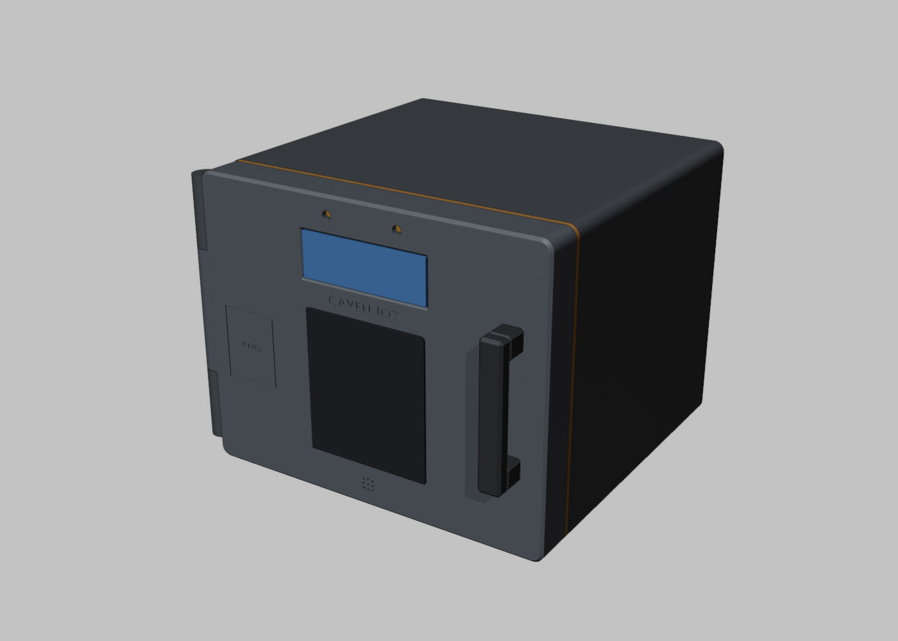

# Caveu IOT

Cassaforte IoT stampabile in 3D: serratura motorizzata (servo **o** stepper), display LCD,
tastierino, lettore RFID, sensore di peso interno e sensore di porta chiusa.



## Struttura

| Percorso | Contenuto |
|---|---|
| `cad/genera_cassaforte.py` | Generatore parametrico Blender (tutte le misure in cima al file) |
| `cad/caveu_cassaforte.blend` | Modello assemblato, con i componenti elettronici di riferimento |
| `cad/render/` | Render di controllo |
| `stl/` | Parti già orientate per la stampa (mm) |

Per rigenerare tutto dopo aver cambiato un parametro:

```bash
/Applications/Blender.app/Contents/MacOS/Blender -b --factory-startup --python cad/genera_cassaforte.py
```

## Dimensioni

- Corpo: 200 × 170 × 160 mm (214 mm di larghezza con la cerniera), pareti da 3 mm, fondo da 4 mm,
  spigoli raccordati R6 e retro smussato
- Porta: 25 mm di spessore totale (guscio frontale + coperchio posteriore da 3 mm)
- Piatto di stampa minimo: **215 × 165 mm** (corpo e porta). Va bene per Ender 3, Prusa MK4,
  Bambu A1/P1/X1. Non entra su piatti 180 × 180.

## Parti da stampare

| STL | Ingombro (mm) | Note |
|---|---|---|
| `corpo.stl` | 214 × 160 × 190 | apertura verso l'alto, senza supporti |
| `porta_guscio.stl` | 214 × 160 × 22 | faccia frontale sul piatto |
| `porta_coperchio.stl` | 199 × 160 × 42 | guide del chiavistello integrate |
| `chiavistello.stl` | 60 × 13 × 8 | cremagliera modulo 1.5 |
| `pignone_servo.stl` | Ø27 × 8 | 16 denti, sede spline SG90/MG90S + vite squadretta |
| `pignone_stepper.stl` | Ø27 × 8 | foro doppio-D per 28BYJ-48 |
| `supporto_servo.stl` | 51 × 26 × 20 | **oppure** `supporto_stepper.stl` |
| `supporto_stepper.stl` | 54 × 22 × 22 | stessi 2 fori di fissaggio del supporto servo |
| `maniglia.stl` | 76 × 20 × 12 | |
| `base_cella.stl` | 100 × 20 × 8 | si avvita al fondo |
| `piatto_peso.stl` | 176 × 112 × 11 | piano da 2 mm con nervature sotto, si stampa nervature sul piatto |
| `pannello_elettronica.stl` | 189 × 148 × 8 | scorre nelle guide, chiude il vano posteriore, asole di ventilazione |

Impostazioni di stampa: vedi [Stampa economica](#stampa-economica).

## Stampa economica

Il modello è stato alleggerito senza cambiare misure esterne né posizione dei componenti:

| Parte | Prima | Ora | Cosa è cambiato |
|---|---|---|---|
| corpo | 768 cm³ | 515 cm³ | pareti 5 → 3 mm (fondo 4 mm), nervature laterali |
| porta_coperchio | 116 cm³ | 98 cm³ | tre tasche di alleggerimento profonde 1.5 mm |
| piatto_peso | 83 cm³ | 61 cm³ | piano 4 → 2 mm con griglia di nervature |
| pannello_elettronica | 76 cm³ | 62 cm³ | 10 asole di ventilazione |
| **totale (versione servo)** | **1210 cm³** | **900 cm³** | **−26% di materiale pieno** |

I volumi sono "pieni": il filamento reale dipende dallo slicer. Con le impostazioni sotto
il set completo pesa indicativamente 0.9–1 kg di PLA (prima 1.2–1.3 kg con 4 perimetri e 25–40%).
Il report del generatore stampa volume e grammi pieni di ogni parte.

Impostazioni consigliate (ugello 0.4 mm, valide per qualsiasi slicer):

| Parti | Layer | Perimetri | Sopra/sotto | Infill |
|---|---|---|---|---|
| corpo, porta_guscio, porta_coperchio, pannello, piatto | 0.24–0.28 mm | 3 | 4 strati | 10% gyroid |
| supporto motore, base cella, maniglia | 0.2 mm | 3 | 4 strati | 30% |
| pignone, chiavistello | 0.2 mm | 6 (o 100%) | — | 100% |

- Con pareti da 3 mm e 3 perimetri le pareti sono quasi tutte perimetro: l'infill serve solo
  in boss, blocchi e fondo, quindi abbassarlo oltre il 10% cambia poco.
- PLA basta per la demo e costa meno del PETG; PETG se deve durare o stare al sole.
- Stampa un solo supporto motore e un solo pignone (servo **oppure** stepper).
- Nessuna parte richiede supporti: gli smussi a 45° sulle facce appoggiate al piatto evitano anche
  il sollevamento degli angoli.
- Per risparmiare tempo: ugello 0.6 mm con layer 0.3 mm su corpo e porta.

## Componenti elettronici previsti

| Componente | Dove | Sede nel modello |
|---|---|---|
| LCD 1602 con backpack I2C | porta | finestra 72 × 25, 4 distanziali M2.5 (75 × 31) |
| Tastierino a membrana 4×4 (69 × 77) | fronte porta | incasso 1 mm + fessura 22 × 3 per il flat |
| RFID RC522 | dietro il fronte porta | parete assottigliata a 1.2 mm, cornice incisa |
| Servo SG90 / MG90S **oppure** stepper 28BYJ-48 + ULN2003 | coperchio porta | supporto dedicato |
| Microswitch finecorsa (20 × 10 × 6) | coperchio porta | blocchetto con 2 fori M2 (homing dello stepper) |
| 2 LED 5 mm (rosso/verde) | porta | fori Ø5.2 |
| Buzzer Ø12 | porta | sede ad anello + griglia |
| Sensore hall A3144/KY-003 + magnete 6 × 2 | corpo / coperchio | rileva la porta chiusa |
| Cella di carico TAL220 80 mm + HX711 | fondo corpo | base + piatto a sbalzo |
| ESP32 DevKit (o Arduino Nano) | vano posteriore | 4 distanziali per millefori 50 × 70 |
| Jack DC 8 mm + USB-C | parete posteriore | fori dedicati |

## Serratura

Chiavistello a **cremagliera e pignone** (modulo 1.5, 16 denti, raggio primitivo 12 mm).
La corsa è di 16 mm: la punta entra di 11 mm nel blocco di riscontro sulla parete destra del corpo.
Con un servo bastano circa 76° di rotazione. Lo stepper usa il microswitch per trovare la posizione
"aperto" all'avvio.

Il motore sta sul coperchio della porta e il cablaggio passa al corpo dall'asola vicino alla
cerniera. Le viti del coperchio si avvitano dall'interno della cassaforte, quindi dall'esterno
non c'è nessuna vite accessibile.

## Minuteria

- Perno cerniera: tondino acciaio Ø3 × 160 mm
- 4 × M3 × 20 svasate (coperchio → guscio)
- 2 × M3 × 10 + dadi (supporto motore → coperchio)
- 2 × M4 × 16 (maniglia), 2 × M3 × 10 + dadi (base cella → fondo)
- Viti cella: 2 × M4 (lato fisso), 2 × M5 (lato piatto)
- 4 × M2.5 × 6 (LCD), 2 × M2 × 8 (servo o microswitch), 2 × M3 × 8 (stepper)

## Da verificare con i componenti reali

Le misure dei componenti sono quelle tipiche dei datasheet. Prima di stampare corpo e porta conviene
controllarle con un calibro e, se serve, correggerle nei parametri del generatore:

- offset dell'albero del servo dal bordo del corpo (impostato a 6 mm)
- interasse dei fori della cella di carico (impostato a 10 mm per lato)
- misure del PCB LCD (80 × 36) e del tastierino (69 × 77)

Conviene stampare per primi chiavistello, pignone e supporto motore per provare l'ingranamento.
